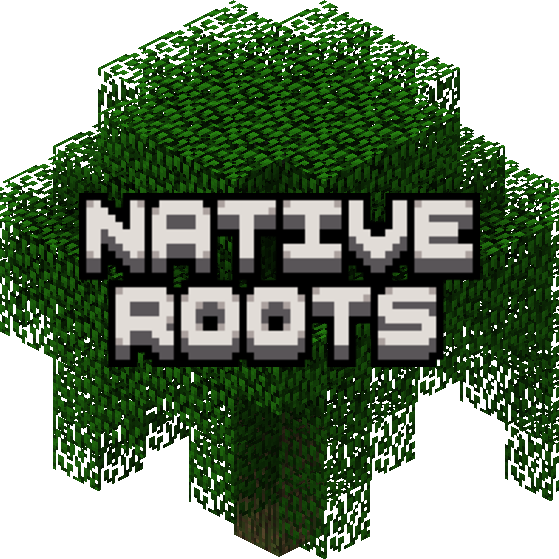

  

# Native Roots - Biome-Aware Saplings

A mod for Better Than Adventure! (BTA). Ever wanted trees to adapt to their environment when planted, without adding dozens of custom sapling items? Native Roots makes it happen!

## Features

- **Swamp Trees:** Oak saplings planted in Swamp biomes grow into swamp trees with mossy logs.
- **Tall Birch Trees:** Birch saplings planted in Birch Forest biomes grow into taller birch trees native to the biome.
- **Rainforest Oaks:** Oak saplings planted in Rainforest biomes grow into lush rainforest trees, including mossy-log variants and an extremely rare chance to grow a massive oak tree.
- **Caatinga Vegetation:** Thorn saplings planted in Caatinga biomes can grow into thorn trees or smaller thorn-leaf shrubs with oak logs.
- **Biome-Specific Growth:** Tree variants are selected according to the biome where the sapling is planted.
- **Native Generation:** Uses BTA's existing tree-generation features for seamless integration with the game's world generation.
- **Configurable:** Toggle biome-aware growth or individual tree variants via Mod Menu or from the config.

## Requires

- [Halplibe](https://modrinth.com/mod/halplibe) *(or Mod Menu for the in-game config screen)*

## Credits

Chilacole - Everything
